# GRAPH - generated by `python3 tools/tickets.py sync`; do not edit by hand

Generated: 2026-11-22 - 63 tickets, DAG (no cycles; enforced by validate).

## Mermaid DAG

```mermaid
graph TD
  DS000["DS-000 Workflow smoke: add docs/workflow-smoke.md through the wo..."]:::done
  DS001["DS-001 Ticket board tool: tools/tickets.py (parse, validate, syn..."]:::done
  DS002["DS-002 Worktree/PR scripts: tools/wt.sh, tools/pr.sh, tools/setu..."]:::done
  DS003["DS-003 Check/bootstrap/CI skeleton: tools/check.sh, packaging/bo..."]:::done
  DS004["DS-004 Cargo workspace skeleton: virtual manifest, crate stubs, ..."]:::done
  DS005["DS-005 Steward role: agents/deckstack-steward.md, tools/steward...."]:::done
  DS006["DS-006 Agent steering validation: AGENTS.md commands actually wo..."]:::done
  DS010["DS-010 ds-protocol: re-export mh-protocol builders + safety test..."]:::done
  DS011["DS-011 ds-state: document, paths, rev/transactions, persistence,..."]:::done
  DS012["DS-012 ds-ipc control plane: Unix socket, NDJSON, hello/auth, sc..."]:::done
  DS013["DS-013 ds-ipc frame plane: DSF1 stream socket, credits/acks, limits"]:::done
  DS014["DS-014 ds-device: virtual transport and report codec (device-agn..."]:::done
  DS015["DS-015 ds-daemon skeleton: state task, IPC server, device task, ..."]:::done
  DS016["DS-016 ds CLI: get/set/watch/schema/describe/daemon/status; outp..."]:::done
  DS017["DS-017 ds-vdev: virtual hub (module reports, chunk reassembly, i..."]:::done
  DS018["DS-018 Black-box conformance harness (pytest): CLI/IPC/state; em..."]:::done
  DS019["DS-019 systemd user unit + daemon lifecycle runbook"]:::doing
  DS020["DS-020 End-to-end walking skeleton: one key image -> vdev reasse..."]:::ready
  DS021["DS-021 Real HID transport on Linux: libusb/hidraw enumeration, o..."]:::backlog
  DS022["DS-022 Software-mode handshake, module init, safe builders on re..."]:::backlog
  DS023["DS-023 Hot-plug rescan, reconnect, re-push, unresponsive-device ..."]:::backlog
  DS024["DS-024 Guard/handback: clean device state on daemon exit, SIGTER..."]:::backlog
  DS025["DS-025 udev rules, device permissions, install docs (Linux)"]:::backlog
  DS026["DS-026 Hardware smoke suite: enumerate, frame, replug, handback ..."]:::backlog
  DS027["DS-027 deckstack-verify camera harness: discovery, calibration, ..."]:::backlog
  DS028["DS-028 Camera golden checks for key:0, panel, LED + calibration ..."]:::backlog
  DS029["DS-029 Safety conformance: forbidden commands, hardware-mode rea..."]:::backlog
  DS030["DS-030 JPEG baseline 4:4:4 encoder + chunking (device wire forma..."]:::backlog
  DS031["DS-031 Frame service: latest-frame-wins queues (1 in flight + 1 ..."]:::backlog
  DS032["DS-032 ds stream CLI: push/stats/stop verbs, --dir/--fps animati..."]:::backlog
  DS033["DS-033 Streaming bench: 32 fps x 60 s sustained on throttled vde..."]:::backlog
  DS034["DS-034 Animation/GIF pipeline: multi-frame decode, <=300 frames ..."]:::backlog
  DS035["DS-035 vdev throttling/backpressure tests: --throttle-kbps, drop..."]:::backlog
  DS040["DS-040 Event bus + router: topics, device input events, exact/wi..."]:::ready
  DS041["DS-041 Bindings: /bindings array with ids (bNNNN), when/payload ..."]:::ready
  DS042["DS-042 Core step vocabulary: set/emit/plugin/exec/sleep executio..."]:::backlog
  DS043["DS-043 Exec policy: /policy/exec allow-deny, admin scope + allow..."]:::backlog
  DS044["DS-044 Transactional event ingest: /focus mirrored from app/focu..."]:::backlog
  DS045["DS-045 Action conformance chains A/B + event latency bench (p99 ..."]:::backlog
  DS050["DS-050 Plugin host in ds-daemon: spawn, hello/register handshake..."]:::backlog
  DS051["DS-051 Rust plugin SDK (ds-plugin-sdk): serve(manifest), @action..."]:::backlog
  DS052["DS-052 ds-plugin-py: Python SDK + hubdeck-compat wrapper (plugin..."]:::backlog
  DS053["DS-053 Plugin abuse tests: fork bomb, memory, cap violation, fs ..."]:::backlog
  DS054["DS-054 Example plugin + plugin docs + packaging: the plugins.md ..."]:::backlog
  DS060["DS-060 ds-focus sender: KWin D-Bus + wlr-foreign-toplevel backen..."]:::backlog
  DS061["DS-061 ds-mcp: stdio MCP bridge over the daemon API (tools/list,..."]:::backlog
  DS062["DS-062 CLI self-description + error contract conformance tests: ..."]:::backlog
  DS063["DS-063 Python/CLI client helper for agents (thin wrapper over ds..."]:::backlog
  DS064["DS-064 Operator runbook: start/stop/restart, logs, token managem..."]:::backlog
  DS070["DS-070 lights.lan plugin repo (deckstack-lights): fake HueMux, l..."]:::backlog
  DS071["DS-071 Selective porting inventory + one button port: old-app be..."]:::backlog
  DS072["DS-072 Windows port breakdown (TODO doc only — do not implement)..."]:::backlog
  DS073["DS-073 macOS port breakdown (TODO doc only — do not implement): ..."]:::backlog
  DS074["DS-074 Optional debug/web client over the WS/HTTP adapter (post-..."]:::backlog
  DS080["DS-080 Fuzz + limits tests for IPC/state/images: malformed NDJSO..."]:::backlog
  DS081["DS-081 Security conformance mapping T1-T12: every threat row get..."]:::backlog
  DS082["DS-082 Performance gates in CI on vdev: wire ds-bench budgets (q..."]:::backlog
  DS083["DS-083 Release packaging: tar/AppImage for Linux, systemd unit i..."]:::backlog
  DS090["DS-090 Workflow hardening smoke: second end-to-end run after the..."]:::done
  DS091["DS-091 pr.sh: automatic rebase conflict resolution for generated..."]:::done
  DS092["DS-092 tickets.py add-touch: extend a ticket's touches without h..."]:::done
  DS093["DS-093 fixture gate: fix the validate.js `not` short-circuit tha..."]:::done
  DS094["DS-094 run-log evidence backfill for the rows flagged by the ind..."]:::ready
  DS001 --> DS006
  DS005 --> DS006
  DS004 --> DS010
  DS004 --> DS011
  DS004 --> DS012
  DS004 --> DS013
  DS004 --> DS014
  DS011 --> DS015
  DS012 --> DS015
  DS014 --> DS015
  DS012 --> DS016
  DS014 --> DS017
  DS003 --> DS018
  DS012 --> DS018
  DS015 --> DS019
  DS015 --> DS020
  DS016 --> DS020
  DS017 --> DS020
  DS018 --> DS020
  DS020 --> DS021
  DS021 --> DS022
  DS022 --> DS023
  DS022 --> DS024
  DS020 --> DS025
  DS023 --> DS026
  DS024 --> DS026
  DS026 --> DS027
  DS026 --> DS028
  DS022 --> DS029
  DS013 --> DS030
  DS020 --> DS030
  DS013 --> DS031
  DS015 --> DS031
  DS020 --> DS031
  DS013 --> DS032
  DS016 --> DS032
  DS020 --> DS032
  DS031 --> DS033
  DS032 --> DS033
  DS030 --> DS034
  DS032 --> DS034
  DS017 --> DS035
  DS032 --> DS035
  DS015 --> DS040
  DS016 --> DS040
  DS017 --> DS040
  DS015 --> DS041
  DS016 --> DS041
  DS041 --> DS042
  DS042 --> DS043
  DS040 --> DS044
  DS041 --> DS044
  DS042 --> DS045
  DS044 --> DS045
  DS042 --> DS050
  DS043 --> DS050
  DS042 --> DS051
  DS043 --> DS051
  DS042 --> DS052
  DS043 --> DS052
  DS050 --> DS053
  DS052 --> DS053
  DS050 --> DS054
  DS052 --> DS054
  DS040 --> DS060
  DS041 --> DS060
  DS040 --> DS061
  DS041 --> DS061
  DS016 --> DS062
  DS040 --> DS062
  DS041 --> DS062
  DS060 --> DS063
  DS061 --> DS063
  DS062 --> DS063
  DS060 --> DS064
  DS061 --> DS064
  DS062 --> DS064
  DS050 --> DS070
  DS052 --> DS070
  DS054 --> DS070
  DS041 --> DS071
  DS070 --> DS071
  DS020 --> DS072
  DS026 --> DS072
  DS020 --> DS073
  DS026 --> DS073
  DS013 --> DS074
  DS032 --> DS074
  DS012 --> DS080
  DS018 --> DS080
  DS031 --> DS080
  DS029 --> DS081
  DS043 --> DS081
  DS053 --> DS081
  DS020 --> DS082
  DS033 --> DS082
  DS045 --> DS082
  DS019 --> DS083
  DS025 --> DS083
  DS082 --> DS083
  classDef backlog fill:#ddd,stroke:#999
  classDef ready fill:#9cf,stroke:#36c
  classDef doing fill:#ff9,stroke:#c90
  classDef review fill:#f9c,stroke:#c39
  classDef done fill:#9c6,stroke:#393
  classDef blocked fill:#f66,stroke:#900
```

## Critical path (longest dependency chain)

DS-004 -> DS-011 -> DS-015 -> DS-041 -> DS-042 -> DS-043 -> DS-050 -> DS-054 -> DS-070 -> DS-071

Critical path length: 10 tickets.

## Parallel lanes

- **agents** (1): DS-063(backlog)
- **bench** (1): DS-033(backlog)
- **build** (1): DS-004(done)
- **ci** (2): DS-003(done), DS-082(backlog)
- **cli** (2): DS-016(done), DS-032(backlog)
- **daemon** (2): DS-015(done), DS-024(backlog)
- **device** (4): DS-014(done), DS-021(backlog), DS-022(backlog), DS-023(backlog)
- **docs** (2): DS-064(backlog), DS-094(ready)
- **frames** (3): DS-030(backlog), DS-031(backlog), DS-034(backlog)
- **integrations** (1): DS-070(backlog)
- **ipc** (2): DS-012(done), DS-013(done)
- **packaging** (3): DS-019(doing), DS-025(backlog), DS-083(backlog)
- **platforms** (2): DS-072(backlog), DS-073(backlog)
- **plugins** (4): DS-050(backlog), DS-051(backlog), DS-052(backlog), DS-054(backlog)
- **porting** (1): DS-071(backlog)
- **protocol** (1): DS-010(done)
- **router** (4): DS-040(ready), DS-041(ready), DS-042(backlog), DS-044(backlog)
- **security** (2): DS-043(backlog), DS-081(backlog)
- **senders** (2): DS-060(backlog), DS-061(backlog)
- **state** (1): DS-011(done)
- **test** (9): DS-018(done), DS-020(ready), DS-026(backlog), DS-029(backlog), DS-045(backlog), DS-053(backlog), DS-062(backlog), DS-080(backlog), DS-093(done)
- **vdev** (2): DS-017(done), DS-035(backlog)
- **verify** (2): DS-027(backlog), DS-028(backlog)
- **web** (1): DS-074(backlog)
- **workflow** (8): DS-000(done), DS-001(done), DS-002(done), DS-005(done), DS-006(done), DS-090(done), DS-091(done), DS-092(done)

## Ready set (state=ready, deps done - claimable now)

- DS-020 - End-to-end walking skeleton: one key image -> vdev reassembled sha; query-under-load bench skeleton (lane test)
- DS-040 - Event bus + router: topics, device input events, exact/wildcard lookup, dispatch ordering (lane router)
- DS-041 - Bindings: /bindings array with ids (bNNNN), when/payload conditions, ds bind/unbind CLI, validation (lane router)
- DS-094 - run-log evidence backfill for the rows flagged by the independent review (lane docs)
