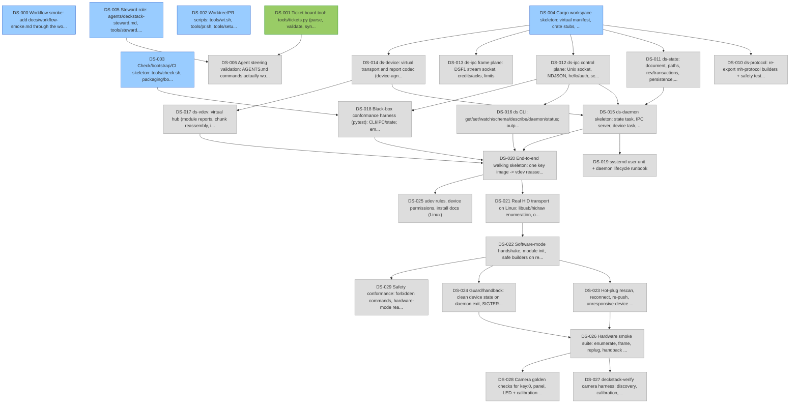

# GRAPH - generated by `python3 tools/tickets.py sync`; do not edit by hand

Generated: 2026-11-22 - 27 tickets, DAG (no cycles; enforced by validate).

## Mermaid DAG

## Critical path (longest dependency chain)

DS-004 -> DS-011 -> DS-015 -> DS-020 -> DS-021 -> DS-022 -> DS-023 -> DS-026 -> DS-027

Critical path length: 9 tickets.

## Parallel lanes

- **build** (1): DS-004(ready)
- **ci** (1): DS-003(ready)
- **cli** (1): DS-016(backlog)
- **daemon** (2): DS-015(backlog), DS-024(backlog)
- **device** (4): DS-014(backlog), DS-021(backlog), DS-022(backlog), DS-023(backlog)
- **ipc** (2): DS-012(backlog), DS-013(backlog)
- **packaging** (2): DS-019(backlog), DS-025(backlog)
- **protocol** (1): DS-010(backlog)
- **state** (1): DS-011(backlog)
- **test** (4): DS-018(backlog), DS-020(backlog), DS-026(backlog), DS-029(backlog)
- **vdev** (1): DS-017(backlog)
- **verify** (2): DS-027(backlog), DS-028(backlog)
- **workflow** (5): DS-000(ready), DS-001(done), DS-002(ready), DS-005(ready), DS-006(backlog)

## Ready set (state=ready, deps done - claimable now)

- DS-000 - Workflow smoke: add docs/workflow-smoke.md through the worktree/PR flow (lane workflow)
- DS-002 - Worktree/PR scripts: tools/wt.sh, tools/pr.sh, tools/setup-review-remote.sh, prs/ scaffold (lane workflow)
- DS-003 - Check/bootstrap/CI skeleton: tools/check.sh, packaging/bootstrap.sh, .github/workflows/ci.yml (lane ci)
- DS-004 - Cargo workspace skeleton: virtual manifest, crate stubs, LICENSE/NOTICE, rustfmt/clippy config (lane build)
- DS-005 - Steward role: agents/deckstack-steward.md, tools/steward.sh, review checklist (lane workflow)
